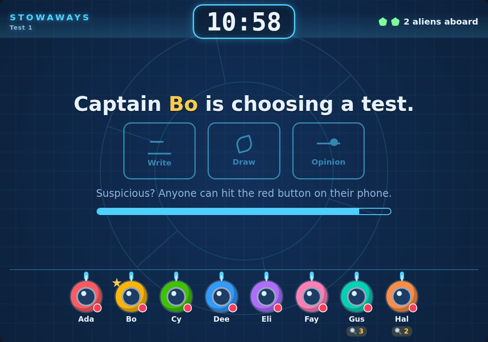
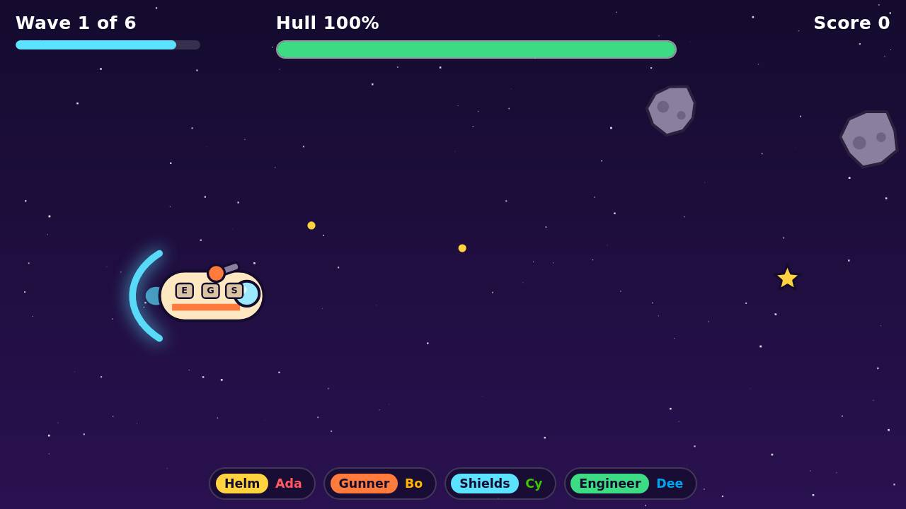
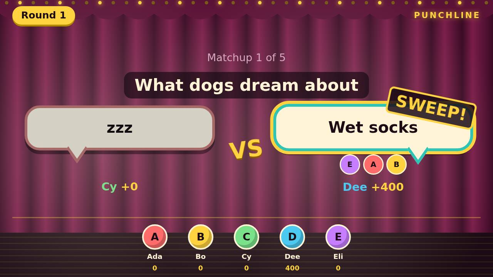
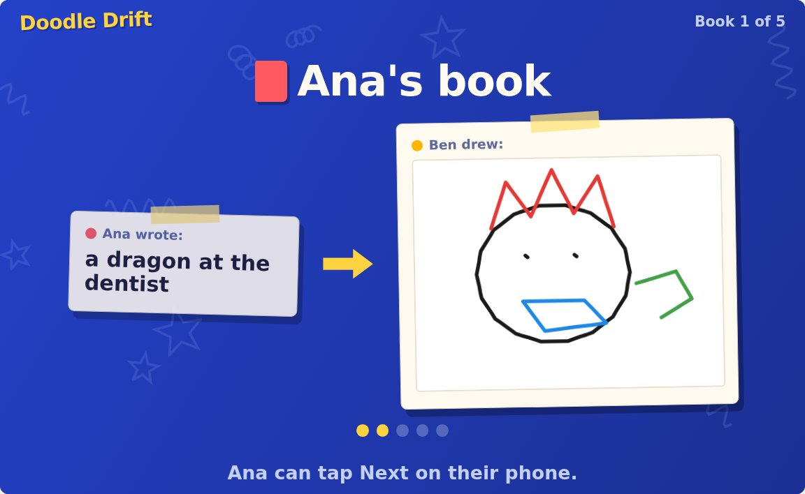

# BoilerGames

**Party games for one big screen and everyone's phones, plus an AI that makes new ones from a
few sentences.** Put a game on a TV or laptop, and everyone joins from their phone's browser with
a room code: no app, no account to play.

**Live at [boilergames.party](https://boilergames.party)**

<p>
  
  
</p>
<p>
  
  
</p>

## What it does

- **Seven games** for 2–12 players: hidden roles (Stowaways), writing and voting (Punchline), drawing
  telephone (Doodle Drift), estimation bets (Ballpark), blind bids (Claim Jumpers), a co-op spaceship
  where every phone is a station (Comet Crew), and a real-time brawler (Bumper Blobs).
- **An AI game maker.** Describe a game in a few sentences and the AI writes a design for you to
  read and edit, then builds the game, plays it with bot phones to catch bugs, reviews its own
  code, and fixes what it finds. Ask for changes in plain English; publish it for everyone.
- **Remix** any public game into your own version to change.
- **Upload your own game file**, written by hand or with any AI (`/kit` has a prompt to copy). It
  goes through the same checks, with no AI or key needed.
- Game pages, votes, profiles, bug reports, and a public guide to how games are made (`/kit`).

## Engineering highlights

- **Untrusted code, contained.** Every game, hand-made or AI-made, is one HTML file that runs in
  a sandboxed iframe with a Content-Security-Policy that blocks all network access. The big screen
  runs the rules; phones are controllers; the server only relays and checks messages and never
  runs game code. A browser test tries nine ways out of the frame on both screens.
- **An AI pipeline that tests its own output.** Design → build → a static check → a playtest in
  headless Chrome with simulated phones → an AI code review → automatic fixes, each step in its
  own sandbox. The playtest catches crashes, games that get stuck (it jumps the clock past the
  game's whole length), a big screen that stops redrawing, players' names injected as HTML, and
  broken values like "NaN" on screen, each with the line of code at fault.
- **Measured, not guessed.** Prompt and pipeline changes were decided by experiments: the same
  design built many ways, results tabulated, and the games read by hand
  ([docs/experiments/](docs/experiments/README.md)). For example, the code review is
  critical-only because that version found the most real bugs with no false alarms.
- **Real-time and resilient.** WebSockets with reconnection, grace periods for dropped phones, and
  games that resume after the big screen reloads mid-round.
- **Security basics done properly.** scrypt password hashes, HttpOnly session cookies stored only
  as hashes, rate limits, users' own GenAI Studio API keys encrypted at rest, and account deletion.
- **Shipped and operated.** AWS EC2 behind Caddy (HTTPS), systemd, nightly backups, and a
  zero-downtime update script that builds aside, tries database migrations on a copy, waits until
  nobody is playing, switches over, and rolls back on failure. Tests run on every push (GitHub
  Actions) and again before every deploy: about 390 server tests, 100 browser tests and the
  game checker's own suite.

## Stack

Node.js, Express and WebSockets (`ws`) · React and Vite · SQLite (`better-sqlite3`) · Playwright ·
Purdue GenAI Studio (an open model, Qwen) · OpenShell sandboxes in Docker · AWS EC2, Caddy, Cloudflare DNS

## How it works

```
 phone (browser)                     server (Node)                    big screen (browser)
┌──────────────────┐   WebSocket   ┌────────────────────┐ WebSocket ┌──────────────────────┐
│ site page        │ ────────────▶ │ rooms, accounts,   │ ────────▶ │ site page            │
│  └ game iframe   │  postMessage  │ checks and relays  │           │  └ game iframe       │
│    (controller)  │ ◀──────────── │ game messages      │ ◀──────── │    (the referee)     │
└──────────────────┘               └────────────────────┘           └──────────────────────┘
                                             │ one job at a time
                                             ▼
                                   ┌────────────────────┐
                                   │ generator, in an   │ ◀── GenAI Studio
                                   │ OpenShell sandbox  │
                                   └────────────────────┘
```

| Folder | What's in it |
|---|---|
| `server/` | The server: rooms (`src/rooms/`), the message relay for games (`src/games/FrameRelay.js`), the HTTP API (`src/http/`), accounts, the database and its migrations (`src/db/`), and the AI job queue (`src/generation/`) |
| `client/` | The website (React): pages, the game frame and the `party` SDK games use (`src/game/frame/`) |
| `server/src/games/<id>/game.html` | The official games, one file each |
| `generator/` | The AI side: prompts, the model calls, the game checker and playtest (`src/check/`), the code reviewer, and the rulebook the AI follows (`spec/`) |
| `e2e/` | Browser tests (Playwright) against a test server with a fake AI |
| `deploy/` | The production setup: Caddy, systemd, backups, the update script |
| `docs/` | [PLAN.md](docs/PLAN.md) (every design decision, as it was made), [experiments/](docs/experiments/README.md), [history/](docs/history/README.md) |

More: [generator/README.md](generator/README.md) (setting up AI generation),
[deploy/README.md](deploy/README.md) (running it on a server), and the rulebook for game files,
[generator/spec/GAME_SPEC.md](generator/spec/GAME_SPEC.md) (also at `/kit` on the site).

---

## Development

```sh
npm run install:all     # first time only
npm run dev:server      # terminal 1: Express on http://localhost:3000 (restarts on file changes)
npm run dev:client      # terminal 2: Vite on http://localhost:5173 (open this one)
```

Vite forwards `/api` and `/ws` to the server, so the browser only talks to :5173.
To test from phones on the same Wi-Fi: `cd client && npx vite --host`, then open the "Network" URL it prints.
On WSL2, phones can't reach WSL by default: add `networkingMode=mirrored` under `[wsl2]` in
`C:\Users\<you>\.wslconfig`, run `wsl --shutdown`, and allow port 5173 in Windows Firewall.
Some networks (e.g. campus Wi-Fi) block device-to-device traffic; a phone hotspot works instead.

### Tests

```sh
npm test                # server unit + integration tests (Node's built-in test runner)
npm run test:e2e        # browser tests: real Chromium pages against the real client + server
npm run test:check      # the game checker on broken test games (uses the e2e tests' Chromium)
```

To check one game file (game info, static check, and a playtest in a headless browser with
simulated phones; it RUNS the game, so use it on files you wrote or chose):

```sh
npm run check-game -- server/src/games/bumper-blobs/game.html --shots /tmp/shots
```

The browser tests start their own server on :3100 and client on :5174, so they don't touch your
dev servers. That server (`e2e/server/testServer.js`) is the real one plus a test admin account
and a **fake AI generator**, so they need no Docker, API key or network. First-time setup:

```sh
npm --prefix e2e install
npx --prefix e2e playwright install chromium   # downloads a test browser (~150 MB, once)
```

Useful while writing tests: `npm --prefix e2e run test:headed` (watch the browsers),
`npm --prefix e2e run report` (step-by-step trace of a failed test).

### Writing a game

A game is one HTML file. It starts with its info (the only part the server reads), then talks to
the site only through the `party` SDK:

```html
<script type="application/json" id="game-info">
  { "name": "Bumper Blobs", "description": "…", "minPlayers": 2, "maxPlayers": 12 }
</script>
```

- `party.ready(fn)`, `party.on(…)` and `party.now()` work on every screen; phones have
  `party.send(data)`.
- The big screen has `party.setState(player, state)` (kept and resent after a phone reloads),
  `party.sendTo` / `party.sendAll`, `party.save(snapshot)` (restored after a big-screen reload)
  and `party.end({ rankings, scores })`.
- `party.ui` has ready-made phone pieces: `joystick`, `gamepad`, `textInput`, `timer`, `drawPad`,
  `countdown`, `sound`, and `el` (builds elements safely).

The full rules are in [GAME_SPEC.md](generator/spec/GAME_SPEC.md). Put a game in
`server/src/games/<id>/game.html` and add its id to `server/src/games/index.js`. Games can also
show approved pictures by id with `party.asset(id)`, from `client/public/game-assets/`
(`manifest.json` lists them; a game can load pictures only from there).

### Accounts and admin tasks

Hosting needs an account; players join as guests with a room code. The database is SQLite at
`server/data/boilergames.db` (created on first start, ignored by git; `DB_PATH` picks another
file, and tests use an in-memory one). It upgrades itself on startup
(`server/src/db/migrations.js`), saving a copy first. Admin tasks run on the server machine:

```sh
npm run admin -- users                 # list accounts
npm run admin -- grant <username>      # make an account an admin
npm run admin -- games                 # list AI-made games, their versions, and what's live
npm run admin -- import-game <file> --owner <username>
npm run admin -- set-live <game id> published|playtest <version|none>
```

### AI-made games

Generation runs in OpenShell sandboxes calling Purdue GenAI Studio; setup is in
[generator/README.md](generator/README.md), and the game server itself runs fine without it.
Turn it on with `GENERATION_ENABLED=1 npm run dev:server`. Anyone with an account and their own
GenAI Studio key (saved, encrypted, on the account page) can make games at `/create`; admins also
have `/admin`. From the command line, `npm run generate -- "<game idea>"` writes a design, lets
you approve it, builds the game and saves it under `generator/out/`.

## License

[MIT](LICENSE)
